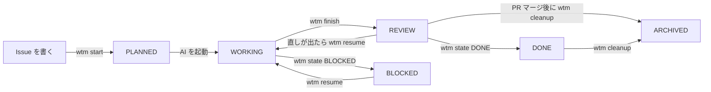

# wtm 開発ワークフローのベストプラクティス

2026-11-05

## 要点

1 つの目的を 1 つの Issue と 1 つの worktree に対応させ、区切りごとに Checkpoint を残し、マージ後に `wtm cleanup` で片付けます。AI の会話ではなく Issue と Checkpoint を作業の記録にすれば、どの AI やセッションからでも作業を再開できます。

守りたい原則は次の 5 つです。

- **Issue を先に書く:** 目的と完了条件がないまま worktree を作らない。
- **1 worktree に AI は 1 つ:** 並列に進めるときは、Issue と worktree を分ける。
- **AI は `wtm` から起動する:** 重複起動の検知と、終了時の履歴バックアップが働く。
- **セッションを閉じる前に Checkpoint を残す:** 次のセッションへの引き継ぎはこれが基本になる。
- **検査を回避しない:** `wtm cleanup` に止められたら、原因を解消してから再実行する。

マージ後に `wtm cleanup` で整理するまでが 1 つの作業の流れです。



*作業状態と遷移させるコマンド*

PR が不要な作業は、ARCHIVED 以外のどの状態からでも `wtm state N DONE` で完了にできます。DONE から戻すときは `wtm state N WORKING --reason "理由"` を使います。

## Issue を書く

Issue は、AI が最初に読む作業指示になります。完了条件をチェックリストで書くと、`wtm review` が未完了の件数を判定できます。

```markdown
## 目的
あとで判断できるように、なぜ必要かを書く

## 範囲
変更するものと、変更しないもの

## 完了条件
- [ ] 確認できる形で書く（テストが通る、画面で動く、など）
```

作業は「並列に進めても衝突しにくい単位」で分けます。同じファイルを変更する Issue を同時に進める場合は、`wtm review` のファイル重複の警告を目安に順番を決めます。

作業中に別の改善点が見つかったら、その worktree では直さず、別の Issue にします。AI に渡す共通指示にも、同じルールが入っています。

## 作業を始める

`wtm start` で worktree とブランチを作り、そのまま AI を起動します。

```bash
wtm start --issue 101                # worktree を作成し、既定の AI を起動
wtm start --issue 101 --no-launch    # worktree だけ作成
wtm start --new --title "タイトル"     # Issue を作成してから開始
```

- **指示の渡し方:** Claude Code には `.wtm/handoff.md` を自動で渡します。Codex には自動で渡せないので、起動後にこのファイルを読むよう伝えます。
- **プロジェクト固有のルール:** 毎回伝えたい共通指示は、管理ディレクトリの `agent-instructions.md` で差し替えられます。`CLAUDE.md` や `AGENTS.md` は `wtm` が変更しません。
- **並列実行:** 端末を Issue ごとに分けて起動します。`wtm start` は AI が終了するまで端末を占有します。
- **同時に進める数:** 自分がレビューできる範囲に抑えます。完成した PR が溜まり始めたら、新しい作業を始めずレビューを先に進めます。

すでに手で作った worktree は、`wtm adopt <パス> --issue 101` で管理下に入れられます。この場合 `TASK.md` は作られません。

## 作業を進める

セッションを閉じる前に Checkpoint を残し、再開は `wtm resume` から行います。

| こんなとき | コマンド | ポイント |
| --- | --- | --- |
| セッションを終える | `wtm checkpoint 101 --from-file .wtm/checkpoint.md` | AI が書いた内容を取り込む。完了・未完了・次のアクションが書かれているか確認する |
| 手で記録する | `wtm checkpoint 101` | 対話で入力できる。コミットはしない |
| 進捗を共有する | `wtm checkpoint 101 --publish` | Issue にコメントする。投稿前に本文を確認する |
| 状況を思い出す | `wtm status 101` | 最終確認日も更新される |
| 続きから始める | `wtm resume 101` | 前回のセッションを再開する |
| 会話が長くなった | `wtm resume 101 --new-session` | Issue と Checkpoint を渡して新しく始める |
| 外部要因で止まった | `wtm state 101 BLOCKED --reason "理由"` | 理由は AI への引き継ぎにも入る |
| 続けるか迷った | `wtm review 101` | 継続・分割・終了の判断材料を出す |

**`auto_checkpoint` を使うか:** `true` にすると AI の終了時に自動で記録します。ただし、AI がファイルを書かなかったときの記録はメタデータだけです。自動の記録があっても、引き継ぎの内容は自分の目で確かめます。

**コミット:** Checkpoint はコミットの代わりになりません。作業内容はこまめにコミットしておきます。

**`wtm list` を毎日見る:** 黄色の行は 7 日以上確認していない作業です。続けるか、止めるか、決めます。

## 作業を終えてマージする

`wtm finish` で PR を作成して REVIEW に進め、マージは人が Gitea で判断します。`wtm` は PR をマージせず、Issue も直接クローズしません。

1. `wtm review 101` で完了条件と警告を確認する。
2. 変更をコミットし、`wtm checkpoint 101` で最後の状態を記録する。
3. `wtm finish 101 --dry-run` で止まる理由がないか見る。
4. `wtm finish 101 --push --create-pr` で PR を作成する。
5. 差分を自分で読んでから、Gitea でマージする。

PR の本文は `Closes #101` で始まるので、マージすると Gitea が Issue を自動でクローズします。

レビューで直しが出たら、`wtm resume 101` で再開します。作業状態は WORKING に戻るので、直した後にもう一度 `wtm finish 101 --push` を実行します。

PR を作らずに終える場合（不要になった作業など）は、`wtm state 101 DONE` で完了にします。DONE の間は AI を起動できません。戻すときは `wtm state 101 WORKING --reason "理由"` を実行します。

## 後片付けする

マージしたら、早めに `wtm cleanup` で worktree を整理します。会話の履歴、Checkpoint、ブランチは残るので、整理してもあとから参照できます。

```bash
cd <main worktree>           # 対象の worktree の外から実行する
wtm cleanup                  # 候補を一覧で確認（何も削除しない）
wtm cleanup 101 --dry-run    # 1 件の検査結果を確認
wtm cleanup 101              # 確認のうえ削除して ARCHIVED にする
```

- **`--yes` より確認画面:** 通常は `--yes` を付けず、検査結果を読んでから答えます。
- **無視ファイルを確かめる:** `.env` やローカル設定は一緒に削除され、アーカイブにも残りません。必要なものは先に退避します。
- **止められたら原因を解消する:** ヒントに従い、消す前に中身を確かめます。`git worktree remove --force` で回避すると、検査もアーカイブも全部飛ばすことになります。
- **ブランチは別に消す:** `wtm cleanup` は消しません。不要なら表示された `git branch -d` を実行します。squash マージでは `-d` が拒否されるので、Gitea でマージを確かめてから対処します。

整理したあとは、次のように参照します。

- **会話を読む:** `wtm history 101`、`wtm history 101 --session <ID>`
- **記録を探す:** `wtm list --archived`
- **作業を再開する:** `wtm start --issue 101`（Issue がクローズ済みなら `--allow-closed`）。同じブランチを再利用し、以前のセッションも再開の候補になります。

## 大きなリポジトリと別 PC

**大きなリポジトリや LFS:** worktree は全ファイルをチェックアウトするので、作成に時間がかかり、その分のディスクも使います。作業ツリーが 4.3 GB のリポジトリでは、作成に約 10 分かかった例があります。

- 作成中は進捗が表示されません。止まって見えても中断しないで待ちます。
- worktree の数はディスク容量から決め、マージしたものはすぐ整理します。
- 無視ファイルに生成物が多い場合、`wtm cleanup` の一覧は全件表示されません（先頭 10 件）。気になるときは `--dry-run --json` で全件を確認します。

**別 PC:** 管理 DB、Checkpoint、セッションのバックアップは PC ごとの管理ディレクトリにあり、共有されません。PC をまたいで作業するときは次のようにします。

1. 元の PC でブランチを push し、`wtm checkpoint 101 --publish` で進捗を Issue に残す。
2. 別の PC で初回だけ `wtm init` を実行する。
3. `git fetch` して、`git branch <ブランチ名> origin/<ブランチ名>` でローカルブランチを作る。
4. `wtm start --issue 101` で再開する。

AI の会話は引き継がれないので、必要な内容は Issue のコメントに残します。ただし、会話の全文や秘密情報は投稿しません。

## こんなときは

### 作業の途中でディレクトリ構造を根本から変えたい

構造変更を専用の Issue にし、ほかの作業を止めて先にマージしてから、残りの worktree に取り込みます。リポジトリ内の構成を変えるだけなら、各 worktree のパスや Issue との対応は変わらず、`wtm` 側の作り直しは不要です。

1. **進行中の作業を仕分ける:** `wtm list` を見て、もうすぐ終わるものは先にマージします。不要なものは `wtm state N DONE` のあと `wtm cleanup N` で片付けます。
2. **途中の作業を止める:** AI を終了してコミットし、`wtm checkpoint 101` のあと `wtm state 101 BLOCKED --reason "ディレクトリ構造の変更待ち"` を実行します。
3. **構造変更だけの PR を作る:** `wtm start --issue 200` で始め、`git mv` だけのコミットと、import やパスを直すコミットを分けます。`CLAUDE.md`、`AGENTS.md`、`.gitignore`、CI 設定の古いパスも直し、機能変更は入れません。
4. **すぐにマージする:** `wtm finish 200 --push --create-pr` のあと Gitea でマージし、`wtm cleanup 200` で片付けます。`wtm review` の変更ファイル数の警告は、この作業では想定内です。
5. **止めていた worktree に取り込む:** 次のコマンドを実行します。移動前のディレクトリに追加したファイルも、移動先へ移ります。
6. **新しいセッションで再開する:** Issue の本文、`TASK.md`、最新の Checkpoint にある古いパスを直してから、`wtm resume 101 --new-session` を実行します。前回の会話を再開すると、AI が古いパスを前提に作業することがあります。

```bash
# 手順 5: 対象の worktree で実行
git fetch origin
git -c merge.directoryRenames=true merge origin/main
```

**rebase は使いません。** push 済みのブランチを rebase すると force push が必要になりますが、`wtm finish` の push は force を使わないので拒否されます。

- **作業中の Issue が多い場合:** 取り込みの競合は Issue の数だけ起きます。一度に全部を移さず、段階を分けることも検討します。
- **スクリプトで移動している場合:** 競合を解消するより、取り込み後にスクリプトを再実行するほうが楽なこともあります。
- **`.gitignore` を変えた場合:** 古い生成物が残ることがあります。`wtm cleanup` の無視ファイルの一覧を確かめます。

この手順は、実際のリポジトリで通しては試していません。最初の 1 件は、取り込み後にテストを実行して確かめます。

### worktree の置き場所を変えたい

今の作業は今の場所で最後まで進めて `wtm cleanup` で整理し、`config.toml` の `worktree_root` を書き換えます。以降の `wtm start` から新しい場所を使います。

`git worktree move` や手動の移動は避けます。`wtm` の DB に古い絶対パスが残るので worktree が存在しない扱いになり、会話履歴との対応付けも切れます。

## 困ったときと制限

記録と実際の状態が合わないと感じたら、まず `wtm doctor` を実行します。

| 症状 | 対応 |
| --- | --- |
| `wtm cleanup` が「AI が動作中の可能性」で止まる | AI を終了しているなら 5 分待って再実行する。表示された PID のプロセスも確かめる |
| `wtm cleanup` が Gitea の接続失敗で止まる | 接続を直して再実行する。`wtm doctor` で接続を確認できる |
| `wtm cleanup` が「マージも push もされていないコミット」で止まる | 必要なコミットなら push して PR を作る。`git log` で内容を確かめて判断する |
| worktree を手で消してしまった | 戻すなら `wtm status` が示すコマンドを実行する。不要なら `wtm cleanup` で記録だけを更新する |
| `wtm start` が途中で失敗する（ロック `initializing` が残る） | 表示された手順に従う。チェックアウトが完了していれば、`git worktree unlock` のあと `wtm adopt` で使える |
| `wtm resume` がセッションを再開できない | 確認に答えると、Issue と Checkpoint を渡して新規セッションで起動する |

運用で気を付けたい制限は次のとおりです。

- **検出できない AI:** Codex と、起動時の作業ディレクトリが worktree の外にある Claude Code は検出できません。`wtm cleanup` の前に、自分で停止を確かめます。
- **直接起動した Claude Code:** 終了時の自動バックアップが動きません。`wtm history 101 --backup` で保全できます。`wtm cleanup` は削除の直前にも自動で保全します。
- **非公開の形式:** Claude Code の履歴の閲覧とプロセス検出は非公開の形式に依存します。形式が変わると、履歴は読めず、プロセスは検出できなくなる可能性があります。
- **機密情報:** セッションのバックアップには機密情報が含まれることがあります。管理ディレクトリを共有やコミットの対象にしません。

## コマンド早見表

| 場面 | コマンド | 変更するもの |
| --- | --- | --- |
| 初期化 | `wtm init` | 管理ディレクトリとローカルの Git 設定 |
| 開始 | `wtm start --issue N` | worktree、ブランチ、`TASK.md` |
| 取り込み | `wtm adopt <パス> --issue N` | 管理 DB のみ |
| 一覧 | `wtm list`、`wtm list --stale` | なし |
| 状態確認 | `wtm status N` | 最終確認日 |
| 記録 | `wtm checkpoint N` | ローカルの Checkpoint |
| 共有 | `wtm checkpoint N --publish` | Gitea の Issue コメント |
| 再開 | `wtm resume N` | 作業状態（WORKING へ） |
| 判断材料 | `wtm review N` | なし |
| 状態変更 | `wtm state N BLOCKED\|DONE\|WORKING` | 作業状態 |
| レビューへ | `wtm finish N --push --create-pr` | リモートのブランチ、Gitea の PR、作業状態 |
| 履歴 | `wtm history N` | セッションの対応表 |
| 整理 | `wtm cleanup N` | worktree の削除、作業状態（ARCHIVED へ） |
| 診断 | `wtm doctor` | なし（`--fix` 指定時のみ記録を修復） |

破壊的な操作と Gitea への書き込みの前には、`--dry-run` で内容を確認できます（`wtm checkpoint --publish` は投稿前に本文を確認します）。
